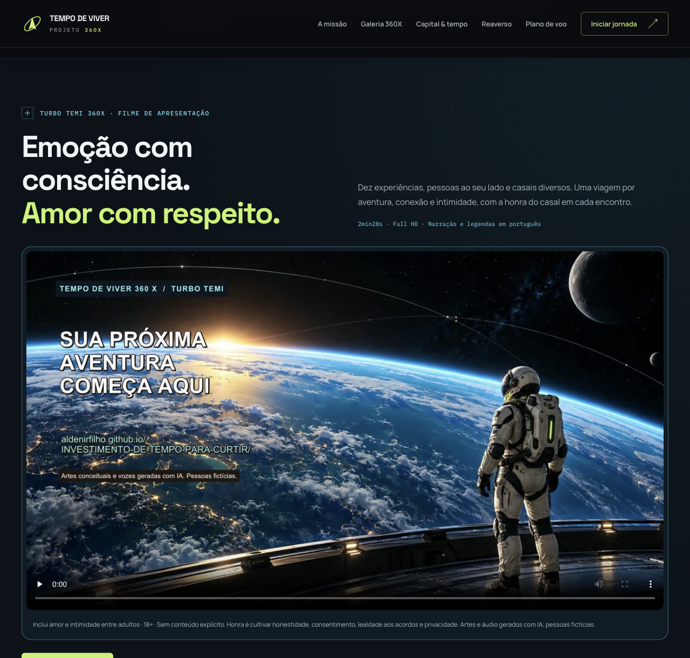

# Tempo de Viver 360X — Investimento de tempo para curtir

Site estático do **Projeto Tempo de Viver 360X**, concebido por Aldenir Rocha de Oliveira Filho.

A proposta: substituir a acumulação financeira sem finalidade por escolhas conscientes sobre o que queremos viver, quanto precisamos para sustentar essas escolhas e quanto tempo estamos dispostos a dedicar ao trabalho, usando tecnologia, inteligência artificial e imaginação (o Reaverso) para diminuir o esforço de organizar experiências, sem abrir mão da proteção financeira.

## O que o site contém

| Seção | Conteúdo |
|---|---|
| A ideia central | Seis dimensões de uma vida boa, proteção financeira como parte da liberdade e nota honesta sobre a metáfora do cigarro |
| Cinco módulos | Bússola do viver · Capital e tempo · Trabalho e aprendizagem · Viver e conviver · IA e Reaverso |
| Bússola do viver (interativa) | Informa tempo, orçamento (inclusive zero), disposição, companhia e interesses; recebe até três sugestões calculadas no navegador |
| Capital e tempo | Tabela de destinos do dinheiro e calculadora “quantas horas de trabalho custa essa compra?” com as três verificações |
| Trabalho e educação | Passos para autonomia no trabalho e trilhas de uma escola mais estimulante |
| Vínculos, prazer e sexualidade | Convivência, eixo adulto (18+) com consentimento, privacidade e saúde sexual; frente juvenil apenas educativa e protetiva |
| IA e Reaverso | Funções da IA com controle da pessoa e os “feitiços” como linguagem criativa |
| Sociedade | Frentes de acesso, governança e sustentabilidade |
| Piloto de 30 dias | Linha do tempo em quatro fases e revisão semanal interativa |
| Erros a evitar, prompt de continuidade e referências | Com links para as fontes |

As respostas da bússola, da calculadora e da revisão semanal não são enviadas nem armazenadas: essas interações rodam localmente no navegador. A tipografia utiliza o Google Fonts, como na versão anterior, com fontes alternativas locais.

## Estrutura

```
index.html   — página única com todas as seções
base.css     — reset e fundamentos
style.css    — tokens de design e componentes
app.js       — bússola, calculadora, revisão semanal, navegação
assets/      — ilustrações (WebP)
docs/        — documento-fonte do projeto (Word)
```

## Publicação

O site é estático e pode ser servido pelo GitHub Pages a partir da branch `main` (raiz). Para rodar localmente:

```bash
python3 -m http.server 8080
# abrir http://localhost:8080
```

## Documento-fonte

`docs/Tempo_de_Viver_360X_Projeto_v1.docx` — projeto conceitual v1 (18 de outubro de 2026), com fundamentos, módulos, piloto, indicadores, prompt de continuidade e referências.

## Identificador de continuidade

- **ID:** 360X-TEMPO-VIVER
- **Estado:** projeto conceitual v1 concluído; implantação em exploração
- **Próxima ação:** escolher uma experiência desejada que já seja acessível e reservar dez minutos para começar


## Edição Orbital — Turbo TEMI 360X

Reestilização de 18/10/2026: grafite, lima e ciano; tipografia Space Grotesk/Manrope; abertura com arte espacial; painéis de instrumentos; navegação móvel com Escape e foco visível. O campo de estrelas é estático para evitar renderização contínua. O conteúdo conceitual e o documento Word foram preservados.

- `galeria.html`: coleção com 10 experiências e downloads individuais.
- `assets/turbo-360x/colecao-turbo-temi-360x.zip`: 10 WebPs, manifesto e nota de uso.
- `assets/turbo-360x/colecao.json`: títulos, descrições, prompts finais, dimensões e hashes SHA-256. Geração pelo **image_gen integrado**, sem uso de API por chave local.
- Widescreen nativo de 1672 × 940 ou 941 px, aproximadamente 16:9, preservado sem recorte ou redimensionamento. WebPs totalizam 3,09 MB; o carregamento da galeria é progressivo.
- Pessoas e situações fictícias: emoção, convivência, inclusão, jogo limpo e diversão sem álcool. Artes conceituais, sem finalidade de instrução técnica.
- Os originais PNG desta execução ficam em `output/artes-originais/`, fora do versionamento público. As ilustrações anteriores permanecem em `assets/`.

### Verificação executada

- `node --check app.js`: sintaxe válida.
- `git diff --check`: sem erros de whitespace.
- Auditoria local por `HTMLParser`: IDs únicos, âncoras e recursos locais existentes em `index.html` e `galeria.html`; todas as imagens possuem texto alternativo.
- ZIP: CRC íntegro; 10 imagens conferidas com hashes do manifesto.
- Navegador local: página principal sem overflow horizontal em 320, 390, 768, 1024 e 1280 px; galeria em 320, 390 e 1280 px.
- Navegador local: menu abre/fecha, Escape devolve foco; bússola apresenta 3 sugestões; compra de R$ 600 com renda de R$ 8.000 e 160 h/mês resulta em 12 h; três verificações atualizam o veredito; revisão semanal responde ao teclado; preferência de movimento reduzido produz rolagem automática.
- Galeria: 10 imagens carregadas, sem imagens quebradas; download do ZIP efetuado no navegador.
- Revisão independente estática: manifesto/ZIP consistentes; WebPs sem EXIF/XMP detectado; sem credenciais ou dados clínicos privados no material novo.

### Comparação visual e revisão humana

| Antes | Depois |
|---|---|
|  |  |


A direção visual foi aprovada para publicação em 18/10/2026. Testes em dispositivos reais e leitores de tela continuam como verificações complementares. O resultado da publicação deve ser confirmado no histórico de implantação do GitHub Pages e no endereço público. Para reverter, reverta o commit da edição orbital e restaure os três arquivos anteriores (`index.html`, `style.css`, `app.js`); não há migração de dados.


## Espaço reservado — Amor & intimidade · 18+

Área editorial opcional na página principal e na galeria, com linguagem positiva sobre desejo, sexo, amor e reciprocidade. Os três princípios são **honra** (honestidade e acordos), **justiça** (liberdade e reciprocidade) e **consciência** (consentimento e limites).

- O elemento HTML `details` inicia fechado e funciona sem JavaScript. Não há cadastro, dados íntimos, cookies ou persistência da abertura.
- “Reservado” indica apresentação discreta: o site, o HTML e a imagem são públicos. Não existe senha, autenticação ou verificação de idade; o aviso 18+ é editorial.
- A arte romântica apresenta casal adulto fictício, vestido, em abraço e beijo suave no cenário orbital. Os arquivos `assets/amor-intimidade-v1.webp` e `assets/amor-intimidade-v1.json` contêm a imagem e seu registro de geração/prompts; o PNG original é preservado localmente fora do versionamento público.
- A coleção de 10 imagens e o ZIP anterior continuam separados deste complemento.

Validação do complemento executada: HTMLParser verificou IDs, âncoras, assets, texto alternativo e estado inicialmente fechado nas duas páginas; hashes do WebP e original conferem. No navegador, Enter abre e Espaço fecha; a galeria aberta não apresentou overflow em 320, 390, 768 e 1280 px, e o complemento da principal foi conferido em 390 px. A arte carregou nas duas páginas. Revisão estática independente sem bloqueadores. Captura: `docs/preview-orbital/intimidade-aberta.png`. Aprovação para publicação recebida em 18/10/2026; a confirmação do deploy depende do GitHub Pages e da leitura do endereço público.


### Honra do casal e relacionamentos modernos

A seção 18+ destaca a dignidade de cada cônjuge ou parceiro, lealdade aos acordos, consentimento prévio para mudanças e privacidade de mensagens/imagens. Inclui explicitamente casais heterossexuais, gays e lésbicos e relações com pessoas bi, trans e de outras identidades, sem associar orientação sexual a práticas ou estilos fixos. Aborda namoro, casamento, relações à distância, monogamia e outros acordos consensuais entre adultos, com espaço para recusar.

Duas artes românticas adicionais de casais adultos fictícios estão em `assets/amor-casal-masculino-v1.webp` e `assets/amor-casal-feminino-v1.webp`, com os respectivos manifestos de prompts, dimensões e hashes. Pessoas vestidas, afeto e nenhuma representação sexual explícita; originais PNG preservados localmente. A coleção original de dez imagens e seu ZIP permanecem íntegros e separados desses complementos.

Validação desta inclusão: HTMLParser aprovou IDs, âncoras, alt e dimensões dos arquivos nas duas páginas; os blocos de intimidade coincidem; todos os hashes/bytes dos novos manifestos foram conferidos na revisão independente. `node --check app.js` e `git diff --check` passaram. A galeria com a seção aberta ficou sem overflow em 320, 390, 768 e 1280 px, com uma coluna para os casais no celular e duas no desktop. As três artes românticas carregaram. Os dez WebPs e o ZIP originais foram conferidos por hash/CRC, sem mudança. O CSS e o JavaScript receberam URLs versionadas para a edição orbital, evitando uso de versões anteriores em cache. Comparação visual adicional: `docs/preview-orbital/honra-diversidade.png`.

## Apresentação em vídeo — Turbo TEMI 360 X

A página inicial inclui o filme em `#apresentacao`, com acesso pelo hero e pela galeria, inclusive pela seção de amor e intimidade. O vídeo reúne as dez experiências e três casais diversos, com destaque à honra, ao consentimento, aos acordos e à privacidade, sem conteúdo explícito.

- `assets/video/apresentacao-turbo-temi-360x-v1.mp4`: H.264/AAC, 1920 × 1080, 30 fps, 147,52 s, 37.320.185 bytes. A cópia web é 50,3% menor que o master preservado localmente e possui carregamento progressivo.
- Player nativo com controles, reprodução no celular, `preload="none"` e início por escolha do visitante. A capa carrega sem baixar o vídeo inteiro.
- Legendas em português gravadas no vídeo, arquivo SRT para download e roteiro completo em HTML, que funciona sem JavaScript.
- `assets/video/manifesto-video-v1.json`: dimensões, tamanho, créditos editoriais e hashes SHA-256. Pessoas fictícias; artes e áudio gerados com IA.
- Arquivos de produção, originais, URLs temporárias e ferramentas locais ficam fora do versionamento público. A integração não acrescenta telemetria, cookies, formulários, APIs ou provedores externos.

Verificações executadas: `git diff --check` e `node --check app.js` sem erros; HTMLParser validou IDs, âncoras, recursos, textos alternativos e atributos do player; FFmpeg decodificou vídeo e áudio completos sem erros. AVFoundation confirmou Full HD, 30 fps, áudio estéreo de 48 kHz e quadros de 3, 95 e 146 segundos, com textos legíveis. No navegador, o vídeo avançou até 9,53 s, sem erro, e a apresentação ficou sem overflow horizontal em 320, 390, 768 e 1280 px. O roteiro contém 16 momentos e o player permanece parado ao abrir a página.



Para comparar, a [abertura da edição anterior](docs/preview-orbital/depois-desktop.png) permanece disponível. A publicação do vídeo foi solicitada em 18/10/2026. Testes em dispositivos físicos e leitores de tela são complementares. A confirmação pública depende do deploy do GitHub Pages e da reprodução no endereço publicado. Reverter o commit desta integração remove o player e os assets novos, sem migração de dados.
