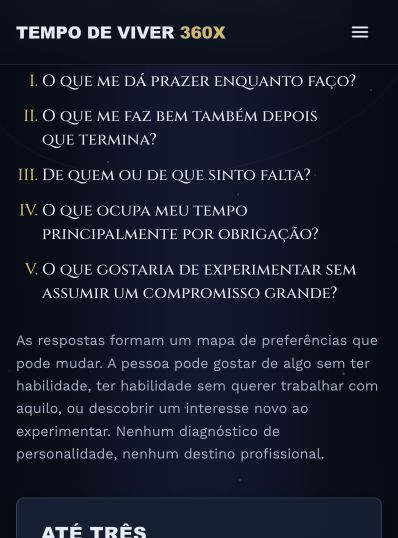
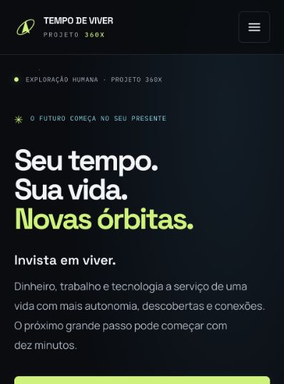
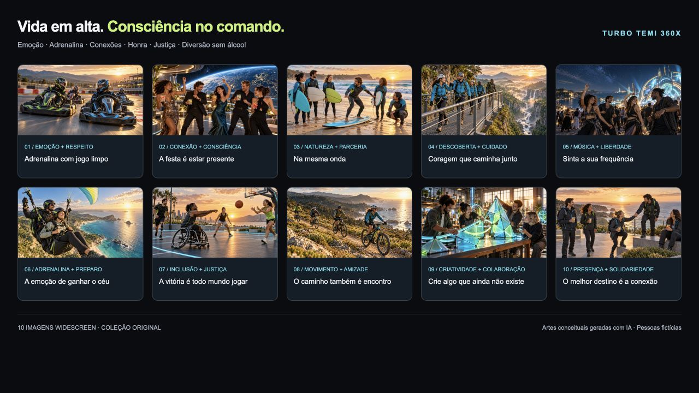

# Tempo de Viver 360X — Investimento de tempo para curtir

Site estático do **Projeto Tempo de Viver 360X**, concebido por Aldenir Rocha de Oliveira Filho.

A proposta: substituir a acumulação financeira sem finalidade por escolhas conscientes sobre o que queremos viver, quanto precisamos para sustentar essas escolhas e quanto tempo estamos dispostos a dedicar ao trabalho, usando tecnologia, inteligência artificial e imaginação (o Reaverso) para diminuir o esforço de organizar experiências, sem abrir mão da proteção financeira.

## O que o site contém

| Seção | Conteúdo |
|---|---|
| A ideia central | Seis dimensões de uma vida boa, proteção financeira como parte da liberdade e nota honesta sobre a metáfora do cigarro |
| Cinco módulos | Bússola do viver · Capital e tempo · Trabalho e aprendizagem · Viver e conviver · IA e Reaverso |
| Bússola do viver (interativa) | Informa tempo, orçamento (inclusive zero), disposição, companhia e interesses; recebe até três sugestões calculadas no navegador |
| Capital e tempo | Tabela de destinos do dinheiro e calculadora “quantas horas de trabalho custa essa compra?” com as três verificações |
| Trabalho e educação | Passos para autonomia no trabalho e trilhas de uma escola mais estimulante |
| Vínculos, prazer e sexualidade | Convivência, eixo adulto (18+) com consentimento, privacidade e saúde sexual; frente juvenil apenas educativa e protetiva |
| IA e Reaverso | Funções da IA com controle da pessoa e os “feitiços” como linguagem criativa |
| Sociedade | Frentes de acesso, governança e sustentabilidade |
| Piloto de 30 dias | Linha do tempo em quatro fases e revisão semanal interativa |
| Erros a evitar, prompt de continuidade e referências | Com links para as fontes |

As respostas da bússola, da calculadora e da revisão semanal não são enviadas nem armazenadas: essas interações rodam localmente no navegador. A tipografia utiliza o Google Fonts, como na versão anterior, com fontes alternativas locais.

## Estrutura

```
index.html   — página única com todas as seções
base.css     — reset e fundamentos
style.css    — tokens de design e componentes
app.js       — bússola, calculadora, revisão semanal, navegação
assets/      — ilustrações (WebP)
docs/        — documento-fonte do projeto (Word)
```

## Publicação

O site é estático e pode ser servido pelo GitHub Pages a partir da branch `main` (raiz). Para rodar localmente:

```bash
python3 -m http.server 8080
# abrir http://localhost:8080
```

## Documento-fonte

`docs/Tempo_de_Viver_360X_Projeto_v1.docx` — projeto conceitual v1 (18 de outubro de 2026), com fundamentos, módulos, piloto, indicadores, prompt de continuidade e referências.

## Identificador de continuidade

- **ID:** 360X-TEMPO-VIVER
- **Estado:** projeto conceitual v1 concluído; implantação em exploração
- **Próxima ação:** escolher uma experiência desejada que já seja acessível e reservar dez minutos para começar


## Edição Orbital — Turbo TEMI 360X

Reestilização de 18/10/2026: grafite, lima e ciano; tipografia Space Grotesk/Manrope; abertura com arte espacial; painéis de instrumentos; navegação móvel com Escape e foco visível. O campo de estrelas é estático para evitar renderização contínua. O conteúdo conceitual e o documento Word foram preservados.

- `galeria.html`: coleção com 10 experiências e downloads individuais.
- `assets/turbo-360x/colecao-turbo-temi-360x.zip`: 10 WebPs, manifesto e nota de uso.
- `assets/turbo-360x/colecao.json`: títulos, descrições, prompts finais, dimensões e hashes SHA-256. Geração pelo **image_gen integrado**, sem uso de API por chave local.
- Widescreen nativo de 1672 × 940 ou 941 px, aproximadamente 16:9, preservado sem recorte ou redimensionamento. WebPs totalizam 3,09 MB; o carregamento da galeria é progressivo.
- Pessoas e situações fictícias: emoção, convivência, inclusão, jogo limpo e diversão sem álcool. Artes conceituais, sem finalidade de instrução técnica.
- Os originais PNG desta execução ficam em `output/artes-originais/`, fora do versionamento público. As ilustrações anteriores permanecem em `assets/`.

### Verificação executada

- `node --check app.js`: sintaxe válida.
- `git diff --check`: sem erros de whitespace.
- Auditoria local por `HTMLParser`: IDs únicos, âncoras e recursos locais existentes em `index.html` e `galeria.html`; todas as imagens possuem texto alternativo.
- ZIP: CRC íntegro; 10 imagens conferidas com hashes do manifesto.
- Navegador local: página principal sem overflow horizontal em 320, 390, 768, 1024 e 1280 px; galeria em 320, 390 e 1280 px.
- Navegador local: menu abre/fecha, Escape devolve foco; bússola apresenta 3 sugestões; compra de R$ 600 com renda de R$ 8.000 e 160 h/mês resulta em 12 h; três verificações atualizam o veredito; revisão semanal responde ao teclado; preferência de movimento reduzido produz rolagem automática.
- Galeria: 10 imagens carregadas, sem imagens quebradas; download do ZIP efetuado no navegador.
- Revisão independente estática: manifesto/ZIP consistentes; WebPs sem EXIF/XMP detectado; sem credenciais ou dados clínicos privados no material novo.

### Comparação visual e revisão humana

| Antes | Depois |
|---|---|
|  |  |



A revisão visual humana, a experiência em dispositivos reais e o comportamento após publicação no GitHub Pages permanecem pendentes. A branch da edição deve ser revisada antes do merge. Para reverter, reverta o commit da edição orbital e restaure os três arquivos anteriores (`index.html`, `style.css`, `app.js`); não há migração de dados.
